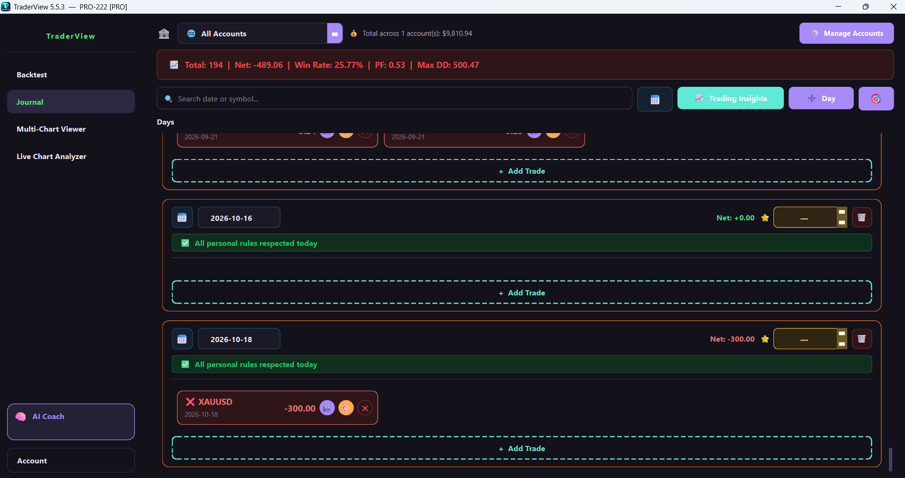
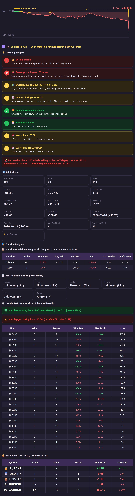

# 🚀 TraderView 5.5.3

**The all-in-one, offline-first desktop application for serious traders.**

TraderView is a comprehensive Windows application designed to help you track, analyze, and improve your trading. It combines a powerful trade journal, a live chart analyzer, Prop Firm challenge tracking, and a unique **Offline Machine Learning AI Coach**—all while keeping 100% of your data private on your own PC. No cloud, no subscriptions, no data leaks.

---

## ✨ Key Features

*   🧠 **Offline AI Coach (Machine Learning):** Trains a local Random Forest model on your historical trades to find your unique edge, warn you before breaking risk limits, and detect anomalies (like FOMO or Revenge trading) without ever connecting to the internet.
*   📊 **Advanced Trade Journal:** Log trades with chart screenshots, emotion tracking, and custom rules. Automatically calculates Win Rate, Profit Factor, Max Drawdown, and Expectancy.
*   🏦 **Multi-Account Manager:** Manage up to 10 separate accounts (Prop Firm, Demo, Personal, Real). Track deposits, withdrawals, and live balances.
*   🎯 **Prop Firm Tracker:** Built-in templates for FTMO, FundedNext, The5ers, and more. Monitors daily loss and max drawdown to prevent rule violations.
*   📈 **Live Chart Analyzer:** Auto-analyzes market structure, RSI, MACD, FVG, Order Blocks, and Fibonacci. Includes a custom box-detection algorithm for breakout setups.
*   🖥 **Multi-Chart Viewer:** Monitor up to 9 charts side-by-side (TradingView, Faraz, Binance, etc.) in one window.
*   🔒 **Privacy & Security First:** Fully offline. Advanced Ed25519 cryptography for license protection. Your data never leaves your machine.

---

## 📥 Download & Installation

1. Go to the **[Releases](../../releases)** section on the right side of this page.
2. Download the latest `TraderView_Setup_5.5.3.exe` file.
3. Run the installer

Rest assured, the application is 100% clean, offline, and safe to use.

---

## 🖼️ Screenshots

---

## 📬 Contact & Support

*   **Developer:** Mohammad Gandomkar
*   **LinkedIn:** [Mohammad Gandomkar](https://www.linkedin.com/in/mohammad-gandomkar-3211b143b)

---

## ⚠️ Disclaimer
*TraderView is an analytical tool and trade journal. It does not provide financial advice or trading signals. All trading decisions and risks remain solely the responsibility of the user.*
